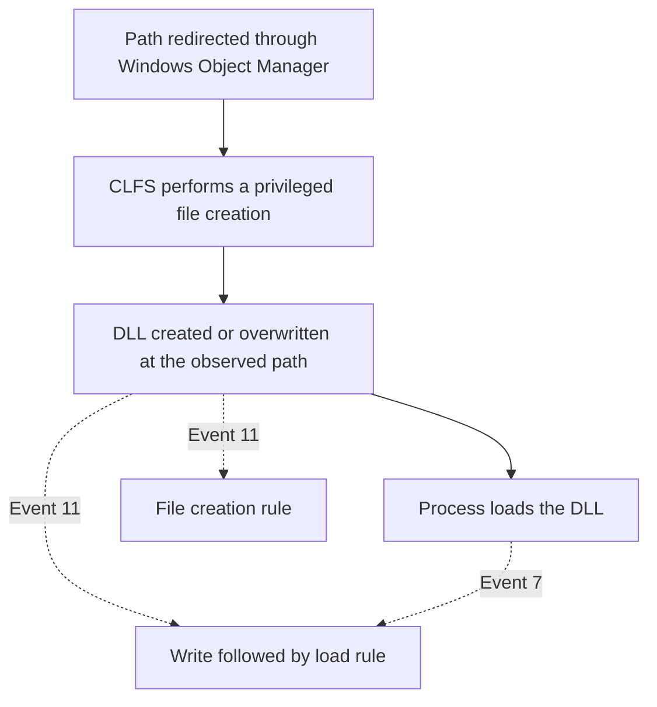

# SignDrop Detection Lab

This offline lab compares two Sysmon detections for a file artifact from the public SignDrop proof of concept. It reads exported Sysmon XML and returns a JSON report with matching event records and gaps in telemetry. The rules cover the DLL write and load late in the published chain. Observing the earlier Windows Object Manager redirection requires separate telemetry. [Cyderes research](https://www.cyderes.com/howler-cell/signdrop-zero-day)

## Where the rules detect activity

The solid arrows mark stages in the published SignDrop chain. The dotted arrows show which Sysmon events feed each rule.



## Detection logic

| Signal | Evidence required |
| --- | --- |
| File creation | Sysmon Event 11 reports creation or overwrite of `hid.dll` under `Program Files\Common Files\microsoft shared\ink` on a drive-letter path. |
| Write followed by load | Sysmon Event 7 reports a load from the same full path on the same host within 120 seconds after the write. |

The report counts one match per qualifying write and uses the earliest subsequent load for that write. Paths are compared case-insensitively and the drive letter is preserved. Events are ordered by the `SystemTime` timestamp and then by `EventRecordID`. The two-minute window is a starting assumption for this comparison. Sysmon ImageLoad collection requires explicit configuration. [Microsoft Sysmon event reference](https://learn.microsoft.com/en-us/sysinternals/downloads/sysmon#events)

## Synthetic results

In the recorded Windows run with Python 3.14.5, all four tests passed. Across five hand-written Sysmon scenarios, the file-creation rule matched four writes. The correlation rule matched one write, found no match in two scenarios, and reported insufficient data in two scenarios. The two coverage gaps were missing ImageLoad collection and an export that ended before the correlation window closed.

This run preceded the Python refactor. Repeat the tests below to verify the current revision.

| Scenario | File creation | Write followed by load |
| --- | --- | --- |
| Same path loaded within 30 seconds | 1 match | 1 match |
| Load on another drive and same-path load outside the window | 1 match | 0 matches |
| ImageLoad collection unavailable | 1 match | Insufficient data |
| Same filename under `Windows\System32` | 0 matches | 0 matches |
| Export ends before the window closes | 1 match | Insufficient data |

`matched` means the export contains the required evidence. `no_match` means no qualifying signal was found given the declared coverage and time bounds. `insufficient_data` means coverage was unknown, unavailable, or truncated and the export contained zero matches for that strategy. An observed match can coexist with a coverage gap affecting the rest of the capture.

## Running the lab

Use an existing Python 3.11 or newer installation. The analyzer and its tests use the standard library. They read the manifest and event exports, then print results to the console. The optional GitHub Actions workflow starts only with **Run workflow** and checks out this repository on the GitHub runner before running the tests.

```text
python lab.py fixtures/scenarios.json
python -m unittest -v
```

## Comparing against observed telemetry

Use a local Sysmon XML export and one manifest entry per host and analysis interval. The XML may contain a single Windows `Event` or an `Events` wrapper around Windows `Event` elements. See [the fixture manifest](fixtures/scenarios.json) for the input format.

### Export from an existing Sysmon log

From PowerShell, check whether you can read the Sysmon channel. If you have an authorized Sysmon `.evtx` export from another Windows machine, you can use that file instead. [Sysmon event reference](https://learn.microsoft.com/en-us/sysinternals/downloads/sysmon#events) · [Get-WinEvent reference](https://learn.microsoft.com/en-us/powershell/module/microsoft.powershell.diagnostics/get-winevent)

```powershell
Get-WinEvent -ListLog 'Microsoft-Windows-Sysmon/Operational' |
    Select-Object LogName, IsEnabled, RecordCount
```

From the repository directory, paste the following block to read events 7 and 11 from the last 15 minutes, write an XML export and manifest under your temporary directory, and print the manifest path. If the interval contains zero matching events, choose a longer interval that your log retains. For an existing `.evtx` export, replace the `LogName` entry with `Path = 'C:\path\to\sysmon.evtx'` and set `$start` and `$end` to the interval covered by the file. [Get-WinEvent filters](https://learn.microsoft.com/en-us/powershell/module/microsoft.powershell.diagnostics/get-winevent#-filterhashtable) · [EventRecord.ToXml](https://learn.microsoft.com/en-us/dotnet/api/system.diagnostics.eventing.reader.eventrecord.toxml)

```powershell
$manifestPath = & {
    $end = Get-Date
    $start = $end.AddMinutes(-15)
    $filter = @{
        LogName = 'Microsoft-Windows-Sysmon/Operational'
        ProviderName = 'Microsoft-Windows-Sysmon'
        Id = 7, 11
        StartTime = $start
        EndTime = $end
    }
    $events = @(Get-WinEvent -FilterHashtable $filter -Oldest -ErrorAction Stop)

    $folder = Join-Path $env:TEMP ('signdrop-sysmon-' + $end.ToString('yyyyMMdd-HHmmss-fff'))
    New-Item -ItemType Directory -Path $folder -ErrorAction Stop | Out-Null
    $xml = @('<Events>') + @($events | ForEach-Object { $_.ToXml() }) + @('</Events>')
    $xml | Set-Content -LiteralPath (Join-Path $folder 'sysmon.xml') -Encoding utf8 -ErrorAction Stop

    $path = Join-Path $folder 'capture.json'
    @{
        captures = @(@{
            id = 'local-sysmon'
            host = $events[0].MachineName
            source = 'observed'
            events = 'sysmon.xml'
            start_utc = $start.ToUniversalTime().ToString('o')
            end_utc = $end.ToUniversalTime().ToString('o')
            collection = @{ file_create = 'unknown'; image_load = 'unknown' }
        })
    } | ConvertTo-Json -Depth 5 | Set-Content -LiteralPath $path -Encoding utf8 -ErrorAction Stop
    $path
}
$manifestPath
```

Then analyze the export in the same PowerShell session.

```powershell
py -3 -B .\lab.py $manifestPath
```

### Interpret the report

For each capture, set `source` to `observed` and record `windows_build`, `sysmon_version`, and `sysmon_config_ref`. Set each collection flag to `collected` when the capture configuration and export include the relevant event type and path range for the full interval. Use `unavailable` for a known collection gap or `unknown` when coverage is uncertain. The analyzer uses those declarations to interpret absent signals.

For a research report, choose documented periods of ordinary use and maintenance. Check `sysmon_event_count` to see how many records the analyzer accepted. Review matching records before labeling an alert benign, and report alerts per host-day only for comparable intervals with adequate coverage. Keep the XML and manifest local and publish the sample duration, match counts, and confirmed benign alerts for each rule.

The fixture results test the analyzer's logic. Logs from ordinary use can measure alert volume and provide examples for false-positive review. Measuring detection coverage requires independently labeled positive telemetry. A match signals an artifact associated with the public SignDrop sample, and attribution requires further investigation. The current comparison covers drive-letter paths for a single published artifact. [Cyderes research](https://www.cyderes.com/howler-cell/signdrop-zero-day)
